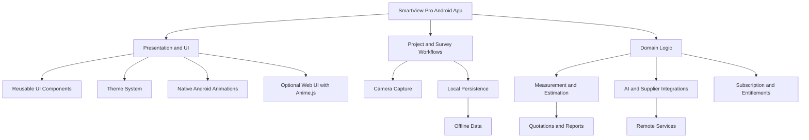

<div align="center">


# WALNUS SMARTVIEW PRO

### Smarter Tools. Bigger Opportunities.

**AI-Assisted Site Surveying · Painting Estimates · Project Intelligence**


[](https://developer.android.com/)
[](https://kotlinlang.org/)
[](#development-lifecycle)
[](#roadmap)

**WALNUS GLOBAL VENTURES**  
*Technology · Manufacturing · Construction · Intelligence*

</div>

---

## ✨ Project Overview

**Walnus SmartView Pro** is an Android application designed to make building-site surveying, painting estimates, and construction project workflows more efficient and measurable.

The product vision combines camera-based site capture, project and survey management, surface measurements, painting quantity estimation, colour visualisation, quotations, and AI-assisted project intelligence.

> **Development rule:** This README is a living project document. Every AI agent and developer must update it as features and modules are implemented, tested, and verified. Never describe a planned feature as completed without evidence.

## 🎯 Core Product Modules

| Module | Purpose | Status |
|---|---|---|
| Project Management | Organise projects, surveys, and site records | Verify against codebase |
| Camera & Site Capture | Capture site images and associate them with surveys | Verify against codebase |
| Smart Survey | Support surface identification and measurement workflows | Planned / verify |
| Painting Intelligence | Estimate paint quantities and materials | Planned / verify |
| Colour Visualisation | Preview proposed building finishes | Planned / verify |
| AI Intelligence | Support research, estimates, and supplier discovery | Planned / verify |
| Quotations & Reports | Produce structured project outputs | Planned / verify |
| Offline Data | Preserve supported workflows without connectivity | Verify against codebase |
| Mix Master | Support paint formulation and material knowledge | Planned / verify |
| Subscription System | Separate free and premium application capabilities | Planned / verify |

**Agent instruction:** Update each status only after reviewing the implementation and performing the relevant tests.

## 🧭 Development Principles

- **Accuracy:** Clearly distinguish measured, inferred, estimated, user-confirmed, and AI-suggested values.
- **Reliability:** Protect existing working features from regressions.
- **Efficiency:** Keep the interface responsive and resource usage appropriate for Android devices.
- **Connectivity:** Handle offline operation and failed network requests gracefully.
- **Modularity:** Develop independent components with defined interfaces.
- **Scalability:** Allow new modules without unnecessary rewrites.
- **Security:** Never expose credentials, API keys, or sensitive data.
- **Transparency:** Report actual build results, test results, and unresolved blockers.

## 🏗️ Application Architecture

The following is the intended logical architecture. Agents must verify the current implementation before creating or renaming modules.



### Architecture rules

1. Keep UI components separate from business logic.
2. Keep database operations behind appropriate data-access interfaces.
3. Isolate camera and hardware-dependent features.
4. Keep AI integrations replaceable and handle service failures.
5. Separate subscription entitlements from core surveying logic.
6. Use reusable components and semantic design tokens.
7. Document significant architectural decisions.

### Anime.js integration

Anime.js is the primary animation engine for **web-based UI components that explicitly adopt the animation system**.

For native Kotlin or Jetpack Compose screens, use native Android animation APIs. Anime.js must not be treated as a native Android component library.

Use animation for:

- Dashboard and card entrances.
- Survey HUD indicators.
- Colour-selection transitions.
- AI processing feedback.
- Report and statistic reveals.
- Web-based navigation transitions.

Animations must not delay critical actions, change measurement results, or compromise low-spec device performance. Support reduced-motion preferences.

## 🎨 User Interface and Themes

SmartView Pro uses a premium, technology-focused design direction inspired by the supplied Walnus campaign artwork.

**Visual identity:**
- Dark industrial surfaces.
- Electric cyan accents.
- Clear, high-contrast typography.
- Professional construction imagery.
- Subtle luminous effects.
- Reusable components and consistent spacing.

### Selectable application themes

| Theme | Purpose |
|---|---|
| SmartView Signature Dark | Premium dark interface with cyan accents |
| Professional Light | Clear business and reporting workflows |
| Construction High Visibility | High-contrast field controls |
| Calm Blue | Restrained professional alternative |
| System Default | Follow Android light/dark preferences |

Implement theme selection through central design tokens rather than hard-coded colours in individual screens.

### Typography and icons

- Proposed typeface: **Inter**, with Android system sans-serif fallback.
- Proposed native icon library: **Material Symbols**, unless an established repository convention takes precedence.
- Prefer vector assets for interface icons.
- Optimise photographic assets for device performance.
- Respect font scaling, contrast, accessibility labels, and touch-target requirements.

These are SmartView Pro design defaults, not claims about the exact implementation of any external reference website.

## 🔄 Mandatory AI Development Workflow

Every SV development stage must follow this sequence:

1. **Understand** — Read the README and all relevant project documentation.
2. **Inspect** — Review the repository, branch, working tree, source files, and existing tests.
3. **Plan** — Define the objective, scope, dependencies, and acceptance criteria.
4. **Implement** — Make focused, modular changes.
5. **Review** — Inspect the diff for defects, security issues, and regressions.
6. **Test** — Run applicable tests and static analysis.
7. **Build** — Build a fresh APK before each qualifying feature-stage commit.
8. **Verify** — Confirm the APK artifact and test the relevant functionality.
9. **Document** — Update the README, progress tracker, and affected documents.
10. **Commit** — Commit only when the applicable requirements pass.
11. **Report** — Produce an SV completion report with evidence and remaining issues.

A failed build must never be reported as successful.

If blocked, record the actual error and leave the stage marked `BLOCKED` or `IN PROGRESS`.

## 📚 Living Documentation System

Keep the following documents aligned with the codebase. Use the filenames already established in the repository if they differ.

| Document | Responsibility |
|---|---|
| `README.md` | Project overview, verified features, setup, module register, and lifecycle |
| `PROJECT_OVERVIEW.md` | Product goals, scope, priorities, and acceptance criteria |
| `AI_WORKFLOW.md` | Mandatory agent workflow and verification rules |
| `ARCHITECTURE.md` | Application layers, interfaces, and technical decisions |
| `CODING_STANDARDS.md` | Coding conventions, security, and quality requirements |
| `UI_CONTEXT.md` | Design system, themes, typography, icons, and animation |
| `PROGRESS_TRACKER.md` | SV stage status, blockers, builds, and tests |
| SV completion reports | Detailed results for each development stage |

### Module Register

Add a new row whenever a meaningful module or feature is introduced. Keep the history and update the evidence as development progresses.

| ID | Module | Stage | Status | Evidence |
|---|---|---|---|---|
| MOD-001 | Project and Survey Foundation | Verify | Verify | Add test/build evidence |
| MOD-002 | Camera and Capture | Verify | Verify | Add test/build evidence |
| MOD-003 | UI Theme System | Pending verification | Planned | Add test/build evidence |
| MOD-004 | Animation System | Pending verification | Planned | Add test/build evidence |
| MOD-005 | Painting Estimates | Pending verification | Planned | Add test/build evidence |
| MOD-006 | Quotations and Reports | Pending verification | Planned | Add test/build evidence |
| MOD-007 | Subscription and Premium | Pending verification | Planned | Add test/build evidence |

**Status vocabulary:** `PLANNED`, `IN PROGRESS`, `BLOCKED`, `IMPLEMENTED`, `TESTED`, `VERIFIED`, `DEFERRED`.

Do not mark a feature `VERIFIED` merely because its source code exists.

## 🧪 Quality Gates

Before marking an SV stage complete:

- [ ] Acceptance criteria satisfied.
- [ ] Code reviewed for security and regression risks.
- [ ] Relevant tests executed.
- [ ] Static analysis completed where configured.
- [ ] APK built successfully before the qualifying commit.
- [ ] APK artifact path recorded.
- [ ] Device testing completed or explicitly marked `NOT TESTED`.
- [ ] README and progress tracker updated.
- [ ] Completion report produced.
- [ ] Commit SHA recorded when applicable.

## 🚀 Getting Started

Clone the repository:

```bash
git clone https://github.com/shawnthedon/Walnus-SmartView-Pro.git
cd Walnus-SmartView-Pro
```

Open the project in a compatible Android development environment or configured cloud workspace.

Before building, verify the project's Gradle wrapper, JDK version, Android SDK requirements, and available build tasks.

Use the repository's configured build process. Record the actual build command and result rather than assuming a task name or claiming an unverified build succeeded.

## 🔐 Security and Data Integrity

- Never commit API keys, access tokens, passwords, or private credentials.
- Request only the Android permissions required by the active features.
- Validate AI-generated and externally retrieved data.
- Label estimates and assumptions clearly.
- Handle offline states and service failures explicitly.
- Preserve users' local survey data according to the approved access policy.
- Do not represent supplier prices as live unless retrieval has succeeded.
- Verify subscription entitlements using the approved secure architecture.

## 🗺️ Roadmap

This roadmap describes intended direction. The development agent must reconcile it with the approved project overview and current progress tracker.

- [ ] Verify and document the current project baseline.
- [ ] Stabilise project, survey, and camera workflows.
- [ ] Establish reusable themes and UI components.
- [ ] Verify performance on low- and high-spec devices.
- [ ] Implement and verify painting quantity estimation.
- [ ] Develop quotation and reporting workflows.
- [ ] Integrate AI-assisted features with clear provenance.
- [ ] Extend approved colour visualisation and finishing workflows.
- [ ] Implement subscription and premium entitlements.
- [ ] Establish reliable automated builds and release artifacts.

## 🤝 Contribution Rules

All developers and AI agents must:

- Read project documentation before implementation.
- Inspect existing code before replacing or duplicating it.
- Keep changes focused and modular.
- Add or update tests for changed behavior.
- Update documentation during the relevant stage.
- Preserve unrelated and concurrent work.
- Report real failures and limitations.
- Avoid claiming completion without evidence.

## 📬 Developer and Company Contacts

<div align="center">

**WALNUS GLOBAL VENTURES**  
*Technology · Manufacturing · Construction · Intelligence*

[Company Website](https://walnusGlobal.octo21st.com.ng) · [Email](mailto:seanlawal@gmail.com)

[LinkedIn — Oluwaseun Lawal](https://www.linkedin.com/oluwaseun-lawal)

[GitHub — shawn-price](https://github.com/shawn-price/) · [GitHub — cyberlawaltech](https://github.com/cyberlawaltech)

</div>

---

<div align="center">

### SMARTER TOOLS. BIGGER OPPORTUNITIES.

*Built iteratively. Verified continuously. Documented throughout the lifecycle.*

</div>
