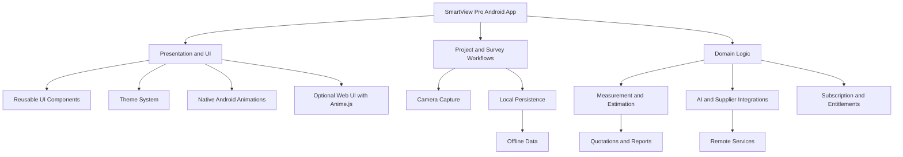

<div align="center">


# WALNUS SMARTVIEW PRO

### Smarter Tools. Bigger Opportunities.

**AI-Assisted Site Surveying · Painting Estimates · Project Intelligence**


[](https://developer.android.com/)
[](https://kotlinlang.org/)
[](#development-lifecycle)
[](#roadmap)

**WALNUS GLOBAL VENTURES**  
*Technology · Manufacturing · Construction · Intelligence*

</div>

---

## ✨ Project Overview

**Walnus SmartView Pro** is an Android application designed to make building-site surveying, painting estimates, and construction project workflows more efficient and measurable.

The product vision combines camera-based site capture, project and survey management, surface measurements, painting quantity estimation, colour visualisation, quotations, and AI-assisted project intelligence.

> **Development rule:** This README is a living project document. Every AI agent and developer must update it as features and modules are implemented, tested, and verified. Never describe a planned feature as completed without evidence.

## 📊 Implementation Status (last updated: SV-001)

This section is factual and kept in step with `Context/progress_tracker.md`. If a
capability is not listed as verified here, treat it as not implemented.

| Area | Status | Evidence |
|---|---|---|
| Project/domain foundation (projects, surveys, surfaces, measurements) | ✅ **Verified** | 26 unit tests, `:core:model` |
| Measurement provenance (measured / inferred / estimated / user-confirmed / AI-suggested) | ✅ **Verified** | Provenance rules enforced and tested |
| Paint estimation (areas, openings, coats, wastage, pack rounding, primer, assumptions) | ✅ **Verified** | 21 unit tests, `:core:estimation` |
| Quotation arithmetic (minor units, discount allocation, basis-point tax) | ✅ **Verified** | 12 unit tests, `:core:quotation` |
| Entitlement gating (free/trial/premium/business, offline grace, forgery resistance) | ✅ **Verified** | 19 unit tests, `:core:entitlements` |
| Trade contract + painting trade registration | ✅ **Verified** | `:core:trade`, `PaintingTrade` |
| Gradle project skeleton, version catalogue, wrapper | ⚠️ **Not executed** | Committed; Gradle could not run in the authoring environment |
| Android app module, screens, themes, navigation | ⛔ **Not started** | Planned for SV-002 |
| Persistence (Room or equivalent), camera, reports/export | ⛔ **Not started** | SV-003+ |
| AI services, supplier discovery, colour visualisation | ⛔ **Not started** | Requires approved provider decisions |
| Billing / subscriptions / backend verification | ⛔ **Not started** | Provider and pricing undecided |
| APK | ⛔ **Blocked** | See note below |

**Verification evidence**

- `docs/build-evidence/sv-001-core-verification.log` — every core module compiled
  independently and **78 / 78 unit tests passed** (`tools/verify-core.sh`).
- `docs/build-evidence/sv-001-apk-build-attempt.log` — the result of the mandatory APK
  build attempt: **BLOCKED**, because the authoring environment has no Android SDK, no
  Gradle distribution and cannot reach Google Maven or Maven Central. No APK exists and
  none is claimed.
- Milestone report: [`docs/reports/SV-001-completion-report.md`](docs/reports/SV-001-completion-report.md).

> Status vocabulary: ✅ Verified (built and tested) · ⚠️ Written but unverified ·
> ⛔ Not started or blocked. A file existing is **not** evidence of a working feature.

## 🎯 Core Product Modules

| Module | Purpose | Status | Evidence |
|---|---|---|---|
| Project Management | Organise projects, surveys, and site records | ✅ Domain model verified · UI not started | `:core:model` tests |
| Camera & Site Capture | Capture site images and associate them with surveys | ⛔ Not started | — |
| Smart Survey | Surface identification and measurement workflow | ✅ Surface/area model verified · UI not started | `:core:model`, `SurfaceAreaCalculator` |
| Painting Intelligence | Estimate paint quantities and materials | ✅ Verified engine · UI not started | `:core:estimation` tests |
| Colour Visualisation | Preview proposed building finishes | ⛔ Not started | — |
| AI Intelligence | Research, estimates, and supplier discovery | ⛔ Not started | Feature keys reserved only |
| Quotations & Reports | Produce structured project outputs | ⚠️ Quotation arithmetic verified · documents/export not built | `:core:quotation` tests |
| Offline Data | Preserve supported workflows without connectivity | ⚠️ Design only (pure domain, no storage yet) | `:core:entitlements` offline policy |
| Mix Master | Paint formulation and material knowledge | ⛔ Not started | — |
| Subscription System | Separate free and premium capabilities | ⚠️ Gating logic verified · no billing | `:core:entitlements` tests |

**Agent instruction:** Update each status only after reviewing the implementation and performing the relevant tests.

## 🧭 Development Principles

- **Accuracy:** Clearly distinguish measured, inferred, estimated, user-confirmed, and AI-suggested values.
- **Reliability:** Protect existing working features from regressions.
- **Efficiency:** Keep the interface responsive and resource usage appropriate for Android devices.
- **Connectivity:** Handle offline operation and failed network requests gracefully.
- **Modularity:** Develop independent components with defined interfaces.
- **Scalability:** Allow new modules without unnecessary rewrites.
- **Security:** Never expose credentials, API keys, or sensitive data.
- **Transparency:** Report actual build results, test results, and unresolved blockers.

## 🏗️ Application Architecture

The following is the intended logical architecture. Agents must verify the current implementation before creating or renaming modules.



### Architecture rules

1. Keep UI components separate from business logic.
2. Keep database operations behind appropriate data-access interfaces.
3. Isolate camera and hardware-dependent features.
4. Keep AI integrations replaceable and handle service failures.
5. Separate subscription entitlements from core surveying logic.
6. Use reusable components and semantic design tokens.
7. Document significant architectural decisions.

### Anime.js integration

Anime.js is the primary animation engine for **web-based UI components that explicitly adopt the animation system**.

For native Kotlin or Jetpack Compose screens, use native Android animation APIs. Anime.js must not be treated as a native Android component library.

Use animation for:

- Dashboard and card entrances.
- Survey HUD indicators.
- Colour-selection transitions.
- AI processing feedback.
- Report and statistic reveals.
- Web-based navigation transitions.

Animations must not delay critical actions, change measurement results, or compromise low-spec device performance. Support reduced-motion preferences.

## 🎨 User Interface and Themes

SmartView Pro uses a premium, technology-focused design direction inspired by the supplied Walnus campaign artwork.

**Visual identity:**
- Dark industrial surfaces.
- Electric cyan accents.
- Clear, high-contrast typography.
- Professional construction imagery.
- Subtle luminous effects.
- Reusable components and consistent spacing.

### Selectable application themes

| Theme | Purpose |
|---|---|
| SmartView Signature Dark | Premium dark interface with cyan accents |
| Professional Light | Clear business and reporting workflows |
| Construction High Visibility | High-contrast field controls |
| Calm Blue | Restrained professional alternative |
| System Default | Follow Android light/dark preferences |

Implement theme selection through central design tokens rather than hard-coded colours in individual screens.

### Typography and icons

- Proposed typeface: **Inter**, with Android system sans-serif fallback.
- Proposed native icon library: **Material Symbols**, unless an established repository convention takes precedence.
- Prefer vector assets for interface icons.
- Optimise photographic assets for device performance.
- Respect font scaling, contrast, accessibility labels, and touch-target requirements.

These are SmartView Pro design defaults, not claims about the exact implementation of any external reference website.

## 🔄 Mandatory AI Development Workflow

Every SV development stage must follow this sequence:

1. **Understand** — Read the README and all relevant project documentation.
2. **Inspect** — Review the repository, branch, working tree, source files, and existing tests.
3. **Plan** — Define the objective, scope, dependencies, and acceptance criteria.
4. **Implement** — Make focused, modular changes.
5. **Review** — Inspect the diff for defects, security issues, and regressions.
6. **Test** — Run applicable tests and static analysis.
7. **Build** — Build a fresh APK before each qualifying feature-stage commit.
8. **Verify** — Confirm the APK artifact and test the relevant functionality.
9. **Document** — Update the README, progress tracker, and affected documents.
10. **Commit** — Commit only when the applicable requirements pass.
11. **Report** — Produce an SV completion report with evidence and remaining issues.

A failed build must never be reported as successful.

If blocked, record the actual error and leave the stage marked `BLOCKED` or `IN PROGRESS`.

## 📚 Living Documentation System

Keep the following documents aligned with the codebase. Use the filenames already established in the repository if they differ.

| Document | Responsibility |
|---|---|
| [`README.md`](README.md) | Project overview, verified features, setup, module register, lifecycle |
| [`Context/project_overview.md`](Context/project_overview.md) | Product goals, scope, priorities, acceptance criteria, implementation status |
| [`Context/ai_workflow.md`](Context/ai_workflow.md) | Mandatory agent workflow, verification gates, evidence rules |
| [`Context/architecture.md`](Context/architecture.md) | Layers, interfaces, ADRs, implemented-vs-target architecture |
| [`Context/Coding_standards.md`](Context/Coding_standards.md) | Conventions, security, testing, modularity, Git practice |
| [`Context/ui_context.md`](Context/ui_context.md) | Design system, themes, typography, icons, animation, UI status |
| [`Context/progress_tracker.md`](Context/progress_tracker.md) | SV status, test and build evidence, blockers, next actions |
| [`docs/reports/`](docs/reports) | One SV completion report per milestone |
| [`docs/build-evidence/`](docs/build-evidence) | Raw logs from verification and build attempts |

### Module Register

Add a new row whenever a meaningful module or feature is introduced. Keep the history and update the evidence as development progresses.

| ID | Module | Stage | Status | Evidence |
|---|---|---|---|---|
| MOD-001 | Domain model (projects, surveys, surfaces, measurements, provenance) | SV-001 | VERIFIED | `:core:model`, 26 tests in `docs/build-evidence/sv-001-core-verification.log` |
| MOD-002 | Painting estimation engine | SV-001 | VERIFIED | `:core:estimation`, 21 tests |
| MOD-003 | Quotation arithmetic | SV-001 | VERIFIED | `:core:quotation`, 12 tests |
| MOD-004 | Entitlements and feature gating | SV-001 | VERIFIED (logic only) | `:core:entitlements`, 19 tests |
| MOD-005 | Trade capability contract | SV-001 | VERIFIED | `:core:trade` |
| MOD-006 | Android app shell and navigation | SV-002 | PLANNED | — |
| MOD-007 | Design system and themes | SV-002 | PLANNED | — |
| MOD-008 | Local persistence and migrations | SV-003 | PLANNED | — |
| MOD-009 | Camera capture and measurement entry | SV-004 | PLANNED | — |
| MOD-010 | Reports and export | SV-005 | PLANNED | — |
| MOD-011 | Plastering and screeding | SV-006 | PLANNED | — |
| MOD-012 | Billing and backend entitlements | SV-007 | DEFERRED (commercial decisions pending) | — |

**Status vocabulary:** `PLANNED`, `IN PROGRESS`, `BLOCKED`, `IMPLEMENTED`, `TESTED`, `VERIFIED`, `DEFERRED`.

Do not mark a feature `VERIFIED` merely because its source code exists.

## 🧪 Quality Gates

Before marking an SV stage complete:

- [ ] Acceptance criteria satisfied.
- [ ] Code reviewed for security and regression risks.
- [ ] Relevant tests executed.
- [ ] Static analysis completed where configured.
- [ ] APK built successfully before the qualifying commit.
- [ ] APK artifact path recorded.
- [ ] Device testing completed or explicitly marked `NOT TESTED`.
- [ ] README and progress tracker updated.
- [ ] Completion report produced.
- [ ] Commit SHA recorded when applicable.

## 🚀 Getting Started

### Requirements

| Tool | Version | Needed for |
|---|---|---|
| JDK | 17+ | everything |
| Kotlin compiler | 2.0+ (`KOTLIN_HOME`) | core verification without Gradle |
| Android Studio / Android SDK | API 35 platform + build-tools | the Android app (SV-002 onwards) |
| Gradle | via the committed wrapper (8.9) | Gradle builds |

### Clone

```bash
git clone https://github.com/walnusglobal-code/smartview-pro-area-base-sv.git
cd smartview-pro-area-base-sv
```

### 1. Verify the calculation core (fast, no Android tooling)

```bash
KOTLIN_HOME=/path/to/kotlinc ./tools/verify-core.sh
```

This compiles each `:core` module in isolation (so illegal cross-module dependencies
fail), runs all unit tests and writes `build/verify/verify-core.log`. Current result:
**78/78 tests passing**.

### 2. Build and test with Gradle

```bash
./gradlew :core:model:test :core:entitlements:test :core:trade:test \
          :core:estimation:test :core:quotation:test
```

### 3. Build the Android app (from SV-002)

```bash
./gradlew :app:assembleDebug
# artefact: app/build/outputs/apk/debug/app-debug.apk
```

The `:app` module does not exist yet; `settings.gradle.kts` deliberately does not declare
it, so the project configures cleanly today. The Android build, Gradle wrapper download
and Google Maven access could not be exercised in the authoring environment — do not
treat build files as verified until you have run them.

### Repository layout

```
core/model         Domain types and provenance rules       (no dependencies)
core/entitlements  Plans, snapshots, access decisions      (no dependencies)
core/trade         TradeCapability contract                -> entitlements
core/estimation    Painting area/quantity engine           -> model, trade
core/quotation     Money and quotation arithmetic          (no dependencies)
tools/             Verification scripts and local test runner
docs/              SV reports and build evidence
Context/           The six canonical project documents
```

## 🔐 Security and Data Integrity

- Never commit API keys, access tokens, passwords, or private credentials.
- Request only the Android permissions required by the active features.
- Validate AI-generated and externally retrieved data.
- Label estimates and assumptions clearly.
- Handle offline states and service failures explicitly.
- Preserve users' local survey data according to the approved access policy.
- Do not represent supplier prices as live unless retrieval has succeeded.
- Verify subscription entitlements using the approved secure architecture.

## 🗺️ Roadmap

Completed:

- [x] Establish a documented project baseline.
- [x] Create a modular Gradle foundation with Android-free core modules.
- [x] Implement and verify measurement provenance rules.
- [x] Implement and verify paint quantity estimation (areas, deductions, packs, primer).
- [x] Implement and verify quotation arithmetic.
- [x] Implement and verify entitlement/feature gating with offline policy.
- [x] Provide reproducible core verification with committed evidence logs.

Next:

- [ ] Clear the Android build blocker and run `./gradlew build` (G2/G3 gates).
- [ ] SV-002: app shell, Compose design system with four themes, project list, estimator
      screen wired to the core, first debug APK.
- [ ] SV-003: offline persistence behind repository interfaces, with migration tests.
- [ ] SV-004: camera capture and surface measurement entry.
- [ ] SV-005: quotation/report export and sharing.
- [ ] SV-006: plastering and screeding on the shared trade contract.
- [ ] Verify performance on low- and high-spec devices once an APK exists.
- [ ] Commercial definitions (plans, prices, billing provider) once approved.

## 🤝 Contribution Rules

All developers and AI agents must:

- Read project documentation before implementation.
- Inspect existing code before replacing or duplicating it.
- Keep changes focused and modular.
- Add or update tests for changed behavior.
- Update documentation during the relevant stage.
- Preserve unrelated and concurrent work.
- Report real failures and limitations.
- Avoid claiming completion without evidence.

## 📬 Developer and Company Contacts

<div align="center">

**WALNUS GLOBAL VENTURES**  
*Technology · Manufacturing · Construction · Intelligence*

[Company Website](https://walnusGlobal.octo21st.com.ng) · [Email](mailto:seanlawal@gmail.com)

[LinkedIn — Oluwaseun Lawal](https://www.linkedin.com/oluwaseun-lawal)

[GitHub — shawn-price](https://github.com/shawn-price/) · [GitHub — cyberlawaltech](https://github.com/cyberlawaltech)

</div>

---

<div align="center">

### SMARTER TOOLS. BIGGER OPPORTUNITIES.

*Built iteratively. Verified continuously. Documented throughout the lifecycle.*

</div>
